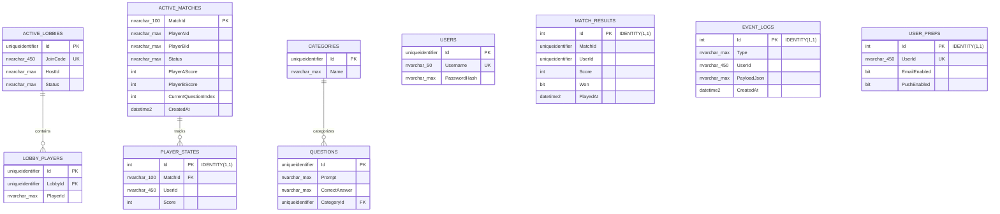

# QuizArena Database Schema

This diagram reflects the SQL Server schema generated by the `InitialCreate` EF Core migration for the `QuizArenaDb` LocalDB database.

## Table and key details

| Table | Purpose | Primary key | Foreign keys | Unique indexes |
|---|---|---|---|---|
| `ActiveLobbies` | Stores active quiz lobbies. | `Id` (`uniqueidentifier`) | None | `JoinCode` |
| `LobbyPlayers` | Stores players belonging to lobbies. | `Id` (`uniqueidentifier`) | `LobbyId` → `ActiveLobbies.Id` | None |
| `ActiveMatches` | Stores live match state and scores. | `MatchId` (`nvarchar(100)`) | None | None |
| `PlayerStates` | Stores per-player state for an active match. | `Id` (`int IDENTITY`) | `MatchId` → `ActiveMatches.MatchId` | `(MatchId, UserId)` |
| `Categories` | Stores question categories. | `Id` (`uniqueidentifier`) | None | None |
| `Questions` | Stores questions and their correct answers. | `Id` (`uniqueidentifier`) | `CategoryId` → `Categories.Id` | None |
| `Users` | Stores registered users and password hashes. | `Id` (`uniqueidentifier`) | None | `Username` |
| `MatchResults` | Stores historical match results. | `Id` (`int IDENTITY`) | None | `(MatchId, UserId)` |
| `EventLogs` | Stores notification and gameplay events. | `Id` (`int IDENTITY`) | None | None |
| `UserPrefs` | Stores notification preferences. | `Id` (`int IDENTITY`) | None | `UserId` |

## Foreign-key behavior

- `LobbyPlayers.LobbyId` references `ActiveLobbies.Id` with cascading delete.
- `Questions.CategoryId` references `Categories.Id` with restricted delete behavior.
- `PlayerStates.MatchId` references `ActiveMatches.MatchId` with cascading delete.

## Important identifier notes

Some domain relationships are represented as application-level identifiers rather than database foreign keys:

- `MatchResults.MatchId` is a `uniqueidentifier`, while `ActiveMatches.MatchId` is an `nvarchar(100)` value.
- `MatchResults.UserId` is a `uniqueidentifier`, while `PlayerStates.UserId`, `EventLogs.UserId`, `UserPrefs.UserId`, and lobby player identifiers are strings.
- `ActiveMatches.PlayerAId`, `ActiveMatches.PlayerBId`, and `ActiveLobbies.HostId` are also string identifiers.

Because these types do not match, the current EF Core model does not enforce foreign keys between those tables and `Users` or between `MatchResults` and `ActiveMatches`. They are correlated by application logic. Normalizing these identifier types would be required before adding database-enforced cross-domain foreign keys.

## SQL Server type mapping

| EF Core/domain type | SQL Server type |
|---|---|
| `Guid` | `uniqueidentifier` |
| `string` without a configured maximum length | `nvarchar(max)` |
| String with configured length 50 | `nvarchar(50)` |
| String with configured length 100 | `nvarchar(100)` |
| String used in an indexed key without an explicit maximum length | `nvarchar(450)` |
| `int` | `int` |
| `bool` | `bit` |
| `DateTime` | `datetime2` |
